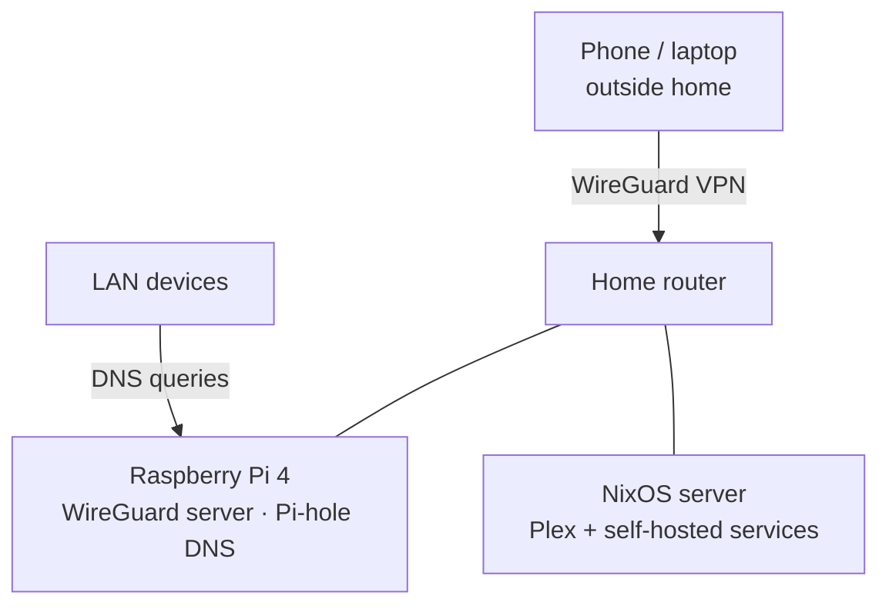

# Homelab

My self-hosted home infrastructure: secure remote access, network-wide DNS filtering and self-hosted services, managed declaratively with **NixOS**.

> Disclaimer: this is a sanitized version of my actual config: addresses, keys, hosts and other details are placeholders or just merely a representation.

## Architecture



| Host | Role | Services |
|---|---|---|
| Raspberry Pi 4 | Network gateway | WireGuard (VPN), Pi-hole (network-wide DNS ad blocking) |
| NixOS server | Application server | Plex and supporting services |
| TP-Link router | Edge router | Dynamic DNS, port forward to WireGuard |

## Highlights

- **Secure remote access:** WireGuard VPN into the home LAN from anywhere; the only port exposed to the internet
- **DNS filtering for every device on the network** with Pi-hole (blocks 21.5% of total queries), also applied to VPN clients
- **Declarative, reproducible config:** the whole server is defined in Nix; any bad change is undone with an instant rollback
- **No containers:** services run natively on NixOS, which solves dependency/version conflicts without Docker
- Administered remotely over SSH (key-only, fail2ban)

## Repository layout

```
.
├── flake.nix                     # entry point: server config, formatter, dev shell
├── lib/
│   └── network.nix               # shared LAN facts: IPs, subnet, VPN port
├── hosts/
│   └── server/                   # NixOS server configuration
│       ├── default.nix           # users, boot, nix settings
│       ├── hardware-configuration.nix
│       ├── networking.nix        # static IP, Pi-hole as DNS, firewall
│       ├── ssh.nix               # hardened OpenSSH + fail2ban
│       └── maintenance.nix       # GC, store optimisation, TRIM
└── docs/
    └── pihole-wireguard.md       # Raspberry Pi setup notes
```

## Usage

```bash
# Format and evaluate
nix fmt
nix flake check

# Deploy to the server from another machine over SSH
nixos-rebuild switch --flake .#server --target-host tiago@192.168.0.10 --sudo

# Something broke? Go back to the previous generation
ssh tiago@192.168.0.10 sudo nixos-rebuild switch --rollback
```

First install: generate the real hardware config on the server and replace the placeholder:

```bash
nixos-generate-config --show-hardware-config > hosts/server/hardware-configuration.nix
```

## Why

I wanted to learn networking and Linux administration beyond the classroom, by running real services I use every day.
For fun and learning process.
